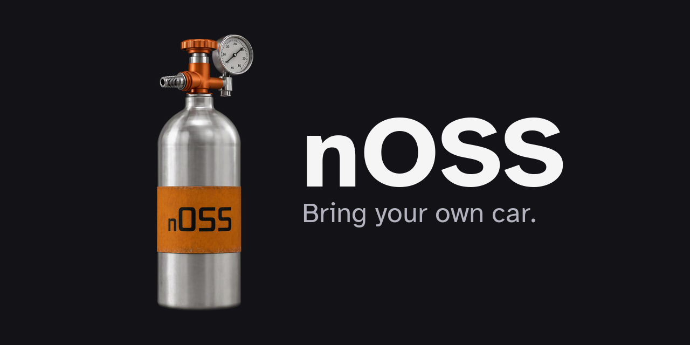

# nOSS

**Bring your own car. The platform decides how it drives.**

nOSS (NOS + Open Source Software) is a free, open-source racing game. You can import almost any 3D vehicle model and mount it on a standardized **platform**. The platform, chosen by gamemode and class, controls all performance and handling, so races stay fair no matter what you bring.

- **Modes:** track racing, kart (with items), highway traffic runs (score attack, two-way loop, police), endless scenic drive
- **Local play:** up to 4 players in splitscreen or one monitor each
- **Online:** up to 16 players on self-hosted servers. Cars and tracks auto-transfer.
- **Input:** keyboard, controller, wheel/pedals/shifter with force feedback
- **Tools:** in-game track editor, plus 3D scene and real-world map import
- **Accessibility:** per-player vision, hearing, motion and input options, plus screen-reader menus
- **Platforms:** Linux, Windows, macOS. Built with Godot 4 + C++.

## Status

**Unreleased: ovals.** **Piedmont Speedway**, a NASCAR quad-oval on the real Charlotte layout: 24° banking, an apron, a SAFER wall and catch fence, night under the lights, and its real pit road. The **Piedmont Road Course** runs through its infield; each shows the other's roads. A **Stock Car** class, and race rules each track can suggest: rolling starts, **drafting**, **fuel and tire wear**, and **pit stops** you set up while driving (fuel and tires, a speed limiter, your own panel in splitscreen). On the oval the AI races in packs: three grooves, runs in the draft, blocks and side-by-side racing. Also the **Eifel GP**, the Nürburgring GP circuit with its real hills.

**`v0.12.0`: the Endless road after driving it.** The road gets **lanes and a side**: two or four lanes (one or two each way), driven on the right or the left, painted to match -- a yellow centre line on the right, all white on the left, and a double line down the middle of four lanes. Traffic has a **Heavy** setting (a car every 8 seconds a lane), the passing lane runs quicker than the edge lane, and **your own cars** turn up in it in their own paints (online, everyone sees the host's). The speed, gear and revs show **by default** now. **Off the road** drives like a dirt road whatever the ground is painted, so a car that runs onto a bank can climb back up it. Each biome has its **speed limit** (lower round tight bends) and signs where it changes, and two new settings: **speed traps** -- cameras and parked patrols that read your speed and keep your best through each one on that road code -- and **police**, who give chase when they see you speeding. The police are smarter everywhere, highways too: more heat brings more of them, faster, and up close they tail you, ram you, try the **PIT** from either side and get ahead to box you in; from heat 3 they lay **spike strips**, patrols ride in the traffic, and traffic moves over for a siren. Busted on the endless road, you're pulled over, then sent on your way. Their close-in steering had been steering *away* from you, which is why they never seemed to try. And the ground behaves: no more ramps of ground poking through where a road meets a bridge, no props hanging where a hill was cut away, and the distant hills -- which had only ever been drawn from below -- show at last. Online is protocol 11; each game runs the police for its own players, and everyone sees everyone's units, sirens and all.

**`v0.11.2`: Sumo Wrestling after playing it.** The bots bring **your** cars now, not sixteen copies of the same box, on an **AI models** setting. The kart **drift** is a setting with three modes: the slide on its own, the slide with the boost a long one charges, or off altogether, which hands the handbrake back. **Crumbling** is its own thing at last instead of Stepped with debris: the platform is sixteen wedges and a bite out of one of them goes about once a second, in an order that takes every wedge once a step, so the rim goes ragged without ever leaving a slot to fall down -- and the last step still comes off as one ring. Whatever is about to go now **lights up** first, in the goo's own colour, laid over exactly the floor that is leaving: the doomed ring on a stepped platform, the next wedge on a crumbling one, a band marching round the rim. Smooth marks nothing, because every edge is going at once. Going **in the goo** no longer parks you under the surface for the rest of the match -- the camera goes up over the arena and follows the fight, and the Camera button cycles a chase on each car still in. And the stack goes to **five** platforms, 24 to 72 m. Online is protocol 10, which is also what finally made the stepped warning work online at all: a client never shrinks a platform, so it had no clock to work the warning out from and had never once shown it.

**`v0.11.1`: the Drag Strip between passes.** Waiting your turn now shows you the pass: the camera goes on the cars that are running — above and behind the leading one, over the centreline, both lanes in frame — and the **Camera** button cycles that view with a chase on either car. Before your own pass a **card** names you, the controls in your hands and what the pass asks of them, and holds the ladder until you have locked in: online too, with a deadline so fifteen people never wait on an empty chair. A pass between two bots can be **hurried along** at four times the speed on the Boost input, and it is the real pass, so the times it sets are the ones it would have set. The water box stays open **eight seconds** instead of five. The pause menu has **Restart event**, which asks first and then runs the same ladder again, drawn into the same pairs. Online is protocol 9.

**Mini Games (`v0.11.0`): Drag Strip.** The second game under **Mini Games**: two lanes, one straight line, and everything riding on your right hand. Stage the car, hold the revs against the **two-step**, watch the tree drop — pre-stage, stage, three ambers, green — and go. Leave early and it is a **red light** and the pass is gone. Your **reaction time** is shown to the thousandth. Down the strip, shift on the **tachometer**: not the engine's, but the mini-game's own needle, which sweeps at the same rate for every car and every model, with a window that comes later and tighter every gear. Land in it for a surge, string them together for a **chain**, miss one and the box grinds and the car bogs. Sit on the limiter too long and you **money-shift** the engine into a cloud of smoke. A spinning launch gives you a moment to catch the **tire shake**; a **burnout** in the water box buys grip if you do not cook them. **0 to 3 bottles** of boost, spent whenever you like. Cross the **centreline** and you have lost the pass. **1/8, 1/4 or 1/2 mile**, three classes (**Street**, **Pro**, **Top Fuel**) that any model can mount, and a **ladder**: pairs run back to back until one car is left. Every prompt names the thing you are actually holding — "Release Space", "A", "Release the clutch", "3rd gate" — so a keyboard, a pad and a wheel with an H-shifter each get told what to do in their own terms. There is **no automatic gearbox** here; timing the shifts is the game. Up to 4 in splitscreen with bots filling the rest, and online for up to 16 (protocol 8).

**Mini Games (`v0.10.0`): Sumo Wrestling.** A new **Mini Games** entry on Solo Drive, for short matches that aren't races, and the first game in it: **Sumo Wrestling**. Shove everyone else off a floating platform into cheesy lava or cheesy green acid. Stack 1 to 3 platforms, each one below wider than the one above, so being knocked off the top is a second chance rather than the end. The top platform starts shrinking when the lights go out; a lower one only once somebody lands on it. Pick how it goes: the edge creeping **smoothly** in, whole rings breaking off and **crumbling** into the goo, or **stepping** down with a warning each time. The last car not in the goo wins — and if the floor vanishes under the last two, whoever holds on a fraction longer takes it. Optional **sudden death** leaves the bottom platform as a pillar for the final duel. Everyone drives one class, **Sumo**, so nobody wins by bringing a lorry, but you can mount any model you like on it. A rechargeable **Ram** boost is the only weapon: time it, or ride it off the edge yourself. Up to 4 in splitscreen, with bots filling the rest, and online for up to 16 (protocol 7) — the arena is built from the match settings, so there is nothing to download and nothing to agree on. Kart battles no longer show lap times they have no use for.

**M9 (`v0.9.0`): endless and environment.** **Solo Drive** on the title screen now holds every way to drive on this PC: Free Drive, Race, Time Trial, Highway, Kart and the new **Endless**, a calm drive down a road that never ends. The road comes from a seed: seven biomes (coast, forest, farmland, desert canyon, alpine, snow, autumn) follow each other with their own bends, hills, props, sounds and weather, with bridges, guard rails and the sea along the coast. Light traffic both ways (oncoming can be off), an **autodrive** (**O**) to sit back and watch, a hidden HUD, ambient music made from the road's seed (or your own OGG and MP3 files in the `music` folder), and a road code like `FOREST-0007K2Q` to share the same road with a friend. A floating origin keeps it precise however far you go: checked over a 162 km, 2-hour drive. Online, everyone drives the same road as a convoy, spreads out freely and uses **Join** to catch up; the Linux and Windows builds make the same road. **Day, night and weather in every mode:** pick the time of day, how fast it runs and the weather (clear, cloudy, rain, storm, fog, snow, or changing) for any event, or keep the track's own. Rain soaks the road (a quarter less grip on tarmac), snow settles on it (much less), headlights come on at dusk, lightning flashes in storms (a soft pulse with Reduce flashing). Wet laps are tagged on the boards; the track editor sets a track's own sky.

**M8 (`v0.8.0`): kart.** **Kart** on the title screen: races with items, battles and cups, on three kart classes (Light, Medium, Heavy) with the original **nOSS Kart** or any of your cars. Hold **Drift** through a corner to charge a boost (blue, orange, purple); jump, trick, ride walls and loop the loop; fall off and a drone tows you back. Nine items (Nitro, Nitro ×3, Oil Slick, Bolt, Seeker, Leader Hunter, Shield, EMP, Magnet), with better ones further back: the only catch-up. Five new tracks: **Marble Mile**, **Gearworks** (pads, a wall-ride and the loop) and **Skyhop Ridge** (jumps on a hillside), and the arenas **Crate Yard** and **Dust Bowl**. **Battle**: three lives, last one standing or most hits. **Cups**: four races for points, the **Spark Cup** built in, or make your own. The editor builds stunt tracks (boost pads, item rows, jumps, wall-rides, loops) and arenas. Kart races and battles work online (protocol 5): the server rules on items while each game shows its own at once. The item assist uses your item for you; Reduce flashing calms every item effect.

**M7 (`v0.7.0`): highway.** The **Lumen Ring**, an 8.3 km city ring expressway: three lanes each way, a river viaduct, a tunnel, three interchanges and four flyovers that switch carriageway, towers all round. **Traffic** (150 cars by default, up to 400) keeps to its lanes, signals, changes lanes, takes exits and comes back on later, so the same cars come round again. Near a player a car becomes a full physics car that can be hit, spun and wrecked; wrecks close the lane until they're towed. Online, every game runs the same traffic from the server's seed and checks it every second. Four ways to drive: **Cruise**, **Score attack** (near misses over 120 km/h build a combo that banks after 5 s quiet; a touch loses it), **Runs** (rolling start, checkpoints, results) and **Loop** (laps either way, boards per direction). **Police** (optional): speed traps, heat from 1 to 5, pursuits that ram and box in, roadblocks from heat 4; stop with a unit on you and you're busted, get far and out of sight and you've evaded. Two new classes, Highway Super and the police Interceptor, and an original traffic set (hatch, saloon, SUV, van, truck, bus). Horn and headlight flash, name plates, sirens on the sound arrows, and Reduce flashing calms the light bars. The editor builds highways too: lanes, median and shoulders, exits, entries and flyovers, runs, speed traps and zones. Checked with 16 headless players, 150 traffic cars and police online for 10 minutes (no traffic disagreements, under 40 KB/s for most players), at 150 ms with loss, with matching traffic on Linux and Windows builds, and with two players driving opposite ways meeting every lap, about 90% of the traffic coming round again. A Windows PC with a GTX 1060 and an i7-7700 held 60 fps in that 16-player session.

**M6 (`v0.6.0`): track editor.** Build your own tracks in the game: drag out a road (widths, banking, heights, curbs, barriers, run-off, bridges over the ground), shape and paint the terrain (it's ours, no addon), place and scatter props, and set the start, grid, sectors and checkpoints. The AI works out its own line, which you can pin by dragging, and the lap it would do; checks show what's wrong and where. Test-drive from the cursor and come back to the same view with undo intact; autosave every 2 minutes. Tracks save as `.nosstrack` files and go to players who don't have them when they join online. **Track Fitting** turns a GLB, glTF or FBX scene into a track: tag its surfaces (rules by name, or material by material), click along the road, measure its widths, race it. Works with mouse, keyboard or controller, and with a screen reader. Checked with a 3 km track built through the editor's own commands, raced by 8 AI cars and sent online, and a circuit made from the Kenney Racing Kit, fitted and raced.

**`v0.5.1`: playtest fixes.** The pause menu closes again (online too, and with the mouse), menu arrows step both ways with the mouse, the title and Garage paint menus fit the screen, the Garage works by keyboard and controller (confirm on a car for its actions, back to return), the Online Players screen is clearer, and tire sounds can be picked per car: the new **Squeal** (default) or **Classic**, or your own loop.

**M5 (`v0.5.0`): online.** Host from the menu and play (a listen server), or run the headless **dedicated server** from a config file. Up to 16 players per game, splitscreen guests included (up to 4 per connection). Join by address or from the LAN list; the host's router port opens itself (UPnP). Each install has its own key, so kicks, bans and admins stick without accounts; an optional password never travels. Lobby with chat (quick lines for controllers), car picks, ready, kick and ban. Free drive and race weekends online: the server runs the event and fills the grid with AI, cars are shown at the present time, contacts are shared between players, and bad links are ghosted. Cars, custom classes and recordings transfer by hash into a cache; a new player sees every real car in about 25 s (placeholders in the right shape first). Server rules: classes, assists, tuning lock, strict fitting, own sounds, size caps; plausibility checks flag or kick cheats. **Own engine recordings** (OGG or WAV) in the Fitting Bay's Sound step. Checked with 16 headless bots on the dedicated server and at 150 ms simulated round trip, and played over the internet and between Linux and Windows on a LAN.

**M4 (`v0.4.0`): track racing.** Race weekends against up to 15 AI drivers: practice, qualifying and the race (laps or minutes), standing or rolling starts, a grid from qualifying, reversed or random, flags, track limits with warnings and time penalties, and results with each driver's assists. The AI drives the same cars on the same physics as you, follows a racing line, passes, defends, lets faster cars by and keeps out of pile-ups (checked over hundreds of simulated race laps). **Time trial** with a ghost of your best lap and a local leaderboard. **Setups** per class and track. Every assist (stability control new), plus access assists: auto-throttle, brake and steering assist, autodrive. H-shifter, clutch, handbrake levers and button boxes and full force feedback (not yet tried on real hardware); controller rumble. Accessibility: colourblind palettes, narration and a spotter (with captions), volume groups and mono, game speed, HUD presets, a first-boot accessibility screen, and menus that work with a screen reader, keyboard alone or a controller alone.

**M3 (`v0.3.0`): local multiplayer.** Up to four players on one PC. Press any button to join, each player with their own profile, controls, car and settings. Splitscreen in one window (two players stacked or side by side, three with a wide view or a track map, four in quarters), or a fullscreen window per monitor, mixed as you like (1+3, 2+2). Two players can share the keyboard (one side each). Every view has its own HUD, menus and pause, and players can drop in and out mid-drive. Per player: HUD size, menu text size, high-contrast HUD, a clear font, brightness, hold or toggle, one-handed control layouts, full rebinding, and two devices for one car. Four players with 200k-triangle cars run at about 300 fps at 1080p on the dev PC.

**M2 (`v0.2.0`):** bring your own car. The **Fitting Bay** turns a GLB, glTF or FBX into a car with no preparation: it finds the wheels (even when they're part of the body), works out which way is up and forward, scales it, and picks up paint slots, lights and the cockpit. Save and drive, or adjust each step. The **Garage** lists your cars with thumbnails: drive, edit, paint, tune the engine sound, copy, delete. Six classes now: Track Touring, GT, Prototype and Formula, Kart Medium, and Highway Street, each checked by the conformance runner so every model drives exactly the same. Also new: hood and bumper cameras, four synthesized engine sounds you can tune per car, generated LODs. Next up is **M4**, track racing ([roadmap](docs/ROADMAP.md)).

## Playing

- **Solo Drive** on the title screen holds Free Drive, Race, Time Trial, Highway, Kart and Endless.
- **Endless** (Solo Drive): a road code (or New road), the biome it starts in, traffic and oncoming traffic, what happens when players on this PC drift apart (bring the one behind up, or hold the leader back), and the sky; then the class (Cruiser or Sport) and the players. The pause menu has the autodrive (or **O**), Show HUD, the road code (copied to share) and New road; online, Join puts you behind another player. Your own music: OGG or MP3 files in `~/.local/share/nOSS/music/` (`%APPDATA%\nOSS\music` on Windows); otherwise it makes its own.
- **Time and weather:** every event menu (Race, Free Drive, Highway, Kart, Endless, Host) has Time (Track's, Dawn … Night), Time runs (still to 120×) and Weather (Track's, Clear, Cloudy, Rain, Storm, Fog, Snow, Changing). Online admins change them with `/time` and `/weather`.
- **Race** (Solo Drive): pick a class, then the race (practice, qualifying, length, AI cars and skill, start, grid, collisions, track limits), then the players. Results show after each session; Continue goes on to the next.
- **Time Trial**: pick a class and drive laps alone. Your best lap becomes a ghost and goes on the local leaderboard (pause menu → Leaderboard); ghost files from friends dropped in `~/.local/share/nOSS/ghosts/proving_ground/<class>/` can be picked in the pause menu.
- **Kart** (Solo Drive): Race (a track, laps, AI karts, items on or off), Battle (an arena, Last one standing or Most hits, minutes, hits to win) or Cup (the Spark Cup or your own: New cup picks four circuits and their laps), then the players: each picks a car and a class (Light, Medium or Heavy), and any car is shrunk to kart size. **Space** (controller RB) drifts, **E** (LB) uses your item, hold **B** (R3) to throw it back. Kart tracks show "Kart" in the track lists; kart classes can race any track.
- **Highway** (Solo Drive): pick a highway, then the mode (Cruise, Score attack, Run, Loop), traffic (off to 400 cars), police, which way round (or the run), the class and the players. The pause menu turns you round onto the other carriageway or puts you behind a friend; Loop and Score attack boards are under Leaderboard. **H** sounds the horn and **L** flashes the headlights (controller: left stick press and X).
- **Setup** (pause menu, not during races): gearing, brake balance, springs, roll balance, wings, diff, as the class allows. Saved per class and track.
- **Free Drive** (Solo Drive): pick a class (how the car drives), then the **Players** screen. Press any button on a keyboard, controller or wheel to join (up to 4). Each player picks their profile and car (how it looks) on their own card with their own device, and sets their monitor, keyboard side, extra devices and settings there. Ready starts the drive once everyone is ready. The original **nOSS Box** and **nOSS Open** always work; your own cars come from the garage (`~/.local/share/nOSS/garage/` on Linux, `%APPDATA%\nOSS\garage` on Windows).
- **Sharing the keyboard:** set a player's Keyboard to Left side (WASD, Space, Q/E, C, X, R, Tab, Esc) and the right side (arrows, `/` handbrake, `,`/`.` shift, `;` camera, `'` look back, `]` reset, `[` change car, Backspace pause) becomes free for another player.
- **Mid-drive:** a free controller or wheel joins by pressing a button. Pause opens in your own view; Leave drops you out. Splitscreen options (layouts, whose sound you hear, auto resolution) are in Settings.
- **Fitting Bay** on the title screen: Browse to a `.glb`, `.gltf` or `.fbx` (or drop files in the `import` folder next to the garage) and press **Save and drive**. The steps (Orient, Wheels, Scale, Paint, Cockpit, Sound, Save) adjust what it found; Save also offers a test drive that comes back to the bay.
- **Garage** on the title screen: your cars and the built-in ones.
- **Track Editor** on the title screen: start from a template (File → New track) or Import scene, then work through the tools left to right: Road, (Surfaces), Terrain, Paint, Props, Race, Check, File. F5 test-drives from the cursor (F5 again, or the pause menu, comes back); Ctrl+Z undoes. Save puts the track in your tracks (File → Show track files); the track pickers (Free Drive, Race, Time Trial, Host) list it. Mouse, keys or controller: [docs/TRACK_EDITOR.md](docs/TRACK_EDITOR.md#2-editor-tools).
- **Keys** (whole keyboard): arrows or WASD to drive, Space handbrake, E/Q shift, C camera (chase near and far, hood, bumper, cockpit), B look back, R reset car, Tab change car while driving, Esc pause, F3 frame rate. **Controller:** left stick, triggers, A handbrake, bumpers shift, Y camera, R3 look back, View reset, D-pad up change car, Start pause. Every action on every device can be rebound per player (Settings → Buttons and keys); one-handed controller layouts are there too.
- **Wheel:** a player's Settings → Wheel setup. Pick the device, set its rotation, detect steering and pedals by moving them (pedals can be a separate device: add it on the Players screen), tune and test force feedback. Linux needs the system SDL3 (`libsdl3-0` on Ubuntu); Windows builds ship it.
- **Discord:** with Discord running, your profile shows the mode and track, how many are playing and how long the session has run — never your cars or the server. Game settings → **Discord status** turns it off. Source builds need one extra step (below); release builds have it already.
- **Player settings** (each player's own): assists (ABS, traction and stability control; auto gearbox, auto clutch and steer aid as Auto, On or Off, where Auto follows the device; racing line) and access assists (auto-throttle, brake assist, steering assist, autodrive); vision (colours for colourblind players, Reduce flashing, narration, spotter); hearing (captions, shift light, slip indicator, close-car arrows); HUD (Full, Minimal, Off, or element by element); game speed (one player); comfort; HUD size, menu text, high contrast, font, brightness; controls (hold or toggle, menu repeat, controller rumble, rebinding including clutch, gear gates and levers on any device). With the auto gearbox, holding the brake at a standstill selects reverse. Each player's card on the Players screen has **Access** for quick accessibility presets; the same screen opens on first boot.
- **Online** on the title screen. **Players** sets who plays on this PC (up to 4 share one connection). **Host** starts a game others can join: name, password, size, class, free drive, a race weekend, a highway cruise, a kart battle or an endless road, the sky, LAN discovery and the router port; the lobby shows the addresses to share. **Join** by address (`host`, `host:port` or `[ipv6]:port`) or pick a game under *On your network*. In the lobby pick your car and press Ready; the host (or an admin) can Start, and kick or ban from a player's row. Chat in the lobby and from the pause menu; controllers have quick lines. The default port is UDP 47800; if the router won't open it, forward it by hand.
- **Dedicated server:** `noss_server --config server.json` (start from [`data/server.example.json`](data/server.example.json)), or from the project `tools/godot.sh --headless -- --server --config=server.json`. Admins, bans, rules and the event rotation live in the config; type `help` in its console. See [Networking §9](docs/NETWORKING.md#9-dedicated-server).
- **Own engine recordings:** Fitting Bay → Sound → Own recordings. Mono OGG or 16-bit WAV at 44.1 or 48 kHz, one loop per rpm (on and off load) for the engine, exhaust or intake, plus start, limiter and backfire sounds. They travel with the car; servers can turn them off. **Tires** (same step): Squeal or Classic, **Skid** to hear them, or your own tire loop (For: Tires).
- **Game settings:** graphics, units, sound by group (own engine, other engines, tires, effects, music, menus, spotter, narration) and mono, splitscreen.

### Converting FM4 rips (local use only)

```sh
python3 tools/fm4_to_noss.py "<...>/Forza Motorsport 4/models"   # every car folder inside, into the garage
```

Converted packages are marked `personal-use-only` and must never be shared or committed; the game keeps them offline (online car lists leave them out) ([Requirements §6](Requirements.md#6-content-and-legal-policy)).

## Development (Linux)

Needs `git`, `curl`, `unzip`, `python3` (with `venv`) and a C++20 compiler (GCC or Clang).

```sh
git clone --recursive https://github.com/ShadowXCC/nOSS.git   # or: git submodule update --init --recursive
tools/setup_dev.sh                 # pinned Godot in .tools/, SCons in .venv/ (nothing system-wide)
tools/build_native.sh              # builds noss_core into native/bin/
tools/run_tests.sh                 # native, schema, tools, GDScript and conformance tests, a short AI race, boot check
tools/run_conformance.sh           # platform conformance only; report in tests/conformance/out/
tools/race_check.sh --laps=5       # 12-car AI race soak (--seed, --skill=40-100, --bad=stall|early_brake|spin, --platform, --track=<id|file>)
tools/net_check.py --clients 12 --quad 1 --event race --laps 3   # dedicated server + 16 bot players (--rtt, --jitter, --loss, --rate, --fresh, --cheat, --track)
tools/net_sim.py --listen 47820 --to 127.0.0.1:47800 --delay 75   # UDP proxy (75 ms each way):: delay, jitter, loss, bandwidth cap (no root)
tools/a11y_check.py                # boot -> race -> results, online, highway, kart and endless menus and the track editor, over AT-SPI (needs a display; private D-Bus session)
tools/track_check.sh               # M6: a 3 km track built with the editor's commands, raced by AI, sent online to a fresh bot
tools/highway_check.sh --scenario=loop --laps=3   # M7: two players opposite ways round the Lumen Ring (meetings, traffic coming round); default: cruise (--players, --traffic=400)
tools/net_check.py --event highway --clients 12 --quad 1 --traffic 150 --police   # 16 players and traffic online (--dirs opposite, --sub, --desync, --open)
tools/kart_check.sh --karts=8 --laps=2 --track=gearworks   # M8: a field of AI karts with items (--seed, --skill, --class, --odds=cycle, --no-items, --battle=standing|hits, --verbose)
tools/net_check.py --event kart --clients 4 --ai 4 --laps 3   # kart race online (Gearworks; --event battle --rule hits on the Crate Yard)
tools/endless_check.sh --minutes=120 --traffic=normal   # M9: a long autodriven endless drive (precision, memory; --no-rebase, --windowed, --verbose)
tools/endless_determinism.sh       # the Linux and Windows builds make the same endless road (Windows under Wine)
tools/net_check.py --event endless --clients 3 --late 40   # an endless convoy online (--seed; --exported: the exported builds, Windows under Wine)
tools/godot.sh --headless res://tools/make_kart_tracks.tscn   # rebuild the kart tracks (--only=<id>); make_kart_fixture.tscn: the test fixtures
tools/godot.sh --headless res://tools/make_eifel_gp.tscn   # rebuild the Eifel GP from tools/data/eifel_gp.json (python3 -I tools/fetch_eifel_gp.py fetches it again)
tools/godot.sh --headless res://tools/make_piedmont_speedway.tscn   # rebuild Piedmont Speedway from tools/data/piedmont.json (python3 -I tools/fetch_piedmont.py fetches it again)
tools/godot.sh --headless res://tools/make_piedmont_road_course.tscn   # rebuild Piedmont Road Course (from the same data)
tools/traffic_determinism.sh       # the Linux and Windows builds step the same traffic (Windows under Wine)
tools/traffic_bench.sh             # physics cost of full, lite and kinematic cars
tools/godot.sh --headless -s res://tools/make_kenney_circuit.gd   # the Track Fitting test circuit (needs the Kenney Racing Kit, see the script)
tools/godot.sh --headless -s res://tools/cvd_shots.gd -- shot.png   # colour-blind versions of a screenshot
tools/godot.sh                     # runs the game; add -e for the editor
```

**Exports** (Linux and Windows, cross-compiled with LLVM MinGW):

```sh
tools/setup_export.sh              # pinned export templates, LLVM MinGW, SDL3.dll (all project-local)
tools/export.sh                    # builds release noss_core and exports to export/linux, export/windows
tools/export.sh server             # the headless dedicated server: export/server/noss_server.x86_64
```

**Discord Rich Presence is optional and needs one manual step** (D186). The Discord Social SDK only
comes from the authenticated Developer Portal, so unlike every other binary here it cannot be
fetched with a pinned checksum and is not committed. Without it the game builds and runs normally
and simply logs `Discord status off: Discord library not found`. To enable it, download the **C++**
SDK from your application's *Discord Social SDK → Downloads* page at
<https://discord.com/developers/applications>, unzip it so that
`.tools/discord_social_sdk/{include,lib,bin}` exists (or point `DISCORD_SDK_DIR` at it), and run
`tools/setup_export.sh` again. Exported builds bundle the library, so players never need this.

**Dev options** go after `--`, e.g. `tools/godot.sh -- --drive --autodrive --camera=cockpit`: `--drive`, `--car=<path>`, `--platform=<id>`, `--autodrive` (the line follower drives), `--camera=<chase_near|chase_far|hood|bumper|cockpit>`, `--shot=<file.png> --shot-at=<s>`, `--quit-at=<s>`, `--fps`, `--log-drive`, `--swap-car=<path> --swap-at=<s>`, `--menu=<classes|players|settings>`, `--join=<n>` (Players screen: n devices join), `--garage`, `--bay`, `--import=<model>`, `--bay-auto` (save and drive as soon as the import is in), `--bay-step=<step>`.

Racing: `--race` (the last race set up; `--race-laps=<n>`, `--race-ai=<n>`, `--race-practice=<min>`, `--race-quali=<min>`, `--race-start=rolling`, `--race-grid=<qualifying|reverse|random>`), `--time-trial`, `--ai=<n>` (AI racers in free drive; `--ai-skill=<0-100>`, `--ai-builtin`), `--auto-continue`, `--quit-after-results`, `--log-ghost`. Checks: `--no-save`, `--skip-first-boot`, `--screen-reader`, `--p1-profile=<json>`, `--voices`, `--menu=<solo|classes|event|players|settings|online|online-players|tracks|highway|kart|endless>`, `--pause-menu=setup`; `--shot-at` takes a list (`5,30,90`).

Kart: `--kart` (a kart race on the first kart track, or `--track`; `--race-laps`, `--race-ai`, `--platform`), `--battle[=hits]` (`--battle-min=<n>`), `--cup[=<id>]`, `--menu=kart`, `--odds=cycle` (items handed out in turn, checks), `--seed=<n>`, `--kart-debug`.

Endless: `--endless[=<code>]` (a road code, or a new road; `--traffic=off|light|normal`, `--platform`), `--menu=endless`, `--endless-debug` (where the car, road window and traffic are, every second), `--endless-selftest[=<seed>]` (checksums of 200 km of road and ground). Any session's sky: `--time=<dawn…night>`, `--time-rate=<x>`, `--weather=<clear|cloudy|rain|storm|fog|snow|changing>`, `--env-seed=<n>`.

Highway: `--highway` (the first highway, or `--track`; `--sub=<cruise|score|run|loop>`, `--traffic=<cars>`, `--traffic-seed=<n>`, `--police`, `--direction=<-1|both>`, `--run=<id>`, `--players=<n>`), `--speed-factor=<0.5-2>` (autodrive past the limit), `--perf-log` (a frame-time summary every 30 s and at exit), `--traffic-selftest` (step a highway's traffic and print its checksum).

Tracks: `--track=<id|file>` (for `--drive`, `--race`, `--time-trial`), `--editor` (`--editor-track=<id|file>`, `--editor-template=<empty|oval|circuit|figure8>`, `--editor-import=<file>`, `--editor-tool=<road|surfaces|terrain|paint|props|race|check|file>`). With `--perf` the editor prints how long it takes to open, update, brush and autosave.

Online: `--host` (host with the last settings), `--connect=<address>`, `--password=<p>`, `--port=<n>`, `--no-upnp`, `--instance=<n>` (a second copy on one PC with its own settings and key), `--cache=<dir>`, `--net-debug`; dedicated server `--server --config=<file>` (`--min-players=<n>`); headless bot clients `--bot` (used by `tools/net_check.py`).

Local multiplayer: `--players=<n>` (extra players driven by the line follower), `--screens=0,0,1,1` (monitor per player), `--split=<stacked|side>`, `--three=<wide|map>`, `--ai-car=<path>`, `--ai-profile=<json>` (options for those players, e.g. `'{"hud_scale": 1.5}'`), `--pause-at=<s>`, `--perf` (frame, CPU, physics and per-view GPU times), `--fullscreen`, `--no-vsync`. `--shot` saves one PNG per window.

## Docs

| Doc | Contents |
|---|---|
| [Requirements](Requirements.md) | Vision, requirement IDs, non-functional targets, content policy |
| [Architecture](docs/ARCHITECTURE.md) | Engine, languages, layout, runtime systems |
| [Platforms](docs/PLATFORMS.md) | Platform format, classes, fitting and handling normalization |
| [Vehicle packages](docs/VEHICLE_PACKAGE.md) | `.noss` format, model conventions, Fitting Bay, FM4 converter |
| [Physics](docs/PHYSICS.md) | Suspension, tires, drivetrain, assists, FFB |
| [Gamemodes](docs/GAMEMODES.md) | Track, kart, highway, endless, career |
| [Track editor](docs/TRACK_EDITOR.md) | Editor tools, `.nosstrack`, map import |
| [Networking](docs/NETWORKING.md) | Hosting, replication, content transfer |
| [Input](docs/INPUT.md) | Devices, joining, wheels, FFB |
| [Art & audio](docs/ART_AUDIO.md) | Style profiles, cameras, UI, engine sound |
| [Accessibility](docs/ACCESSIBILITY.md) | Vision, hearing, motion, motor and input, pacing |
| [Roadmap](docs/ROADMAP.md) | Milestones and acceptance criteria |
| [Decisions](docs/DECISIONS.md) | Decision log, risks, open questions |

## License

Code is [GPL-3.0-or-later](LICENSE). Original assets are [CC-BY-SA 4.0](LICENSE-ASSETS.md). Third-party credits are in [CREDITS.md](CREDITS.md).
